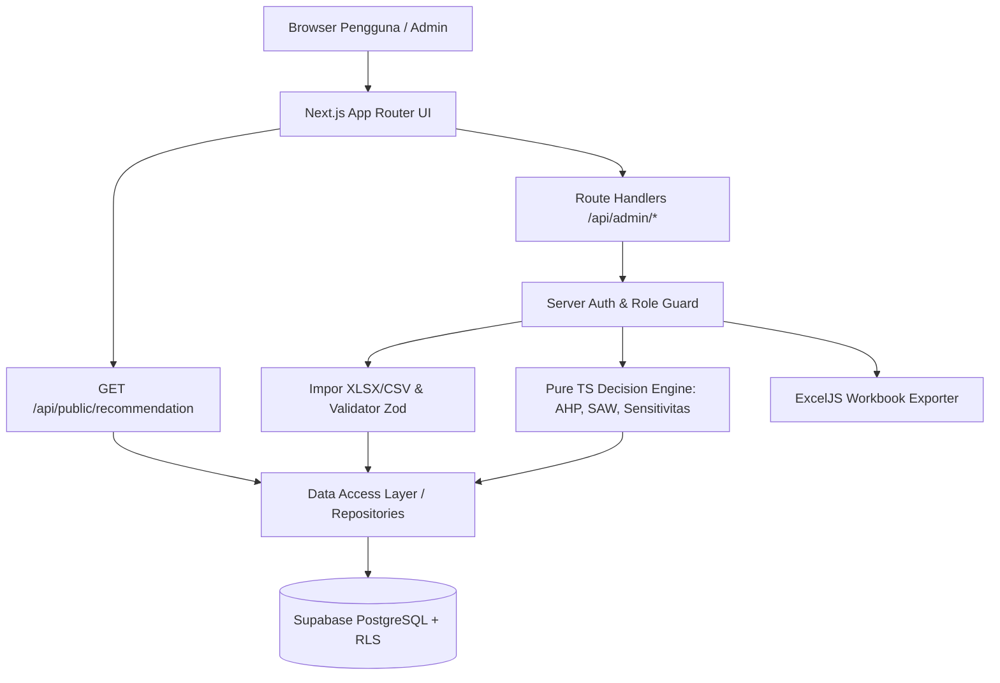

# Arsitektur Sistem — LaptopMatch SPK AHP–SAW

## 1. Gambaran Umum Arsitektur

LaptopMatch dibangun sebagai aplikasi web full-stack monolitik modular berbasis **Next.js App Router** dengan **TypeScript strict** dan **Supabase (PostgreSQL + Auth + RLS)**.



## 2. Pemisahan Tanggung Jawab (Separation of Concerns)

| Lapisan | Lokasi | Tanggung Jawab |
|---|---|---|
| Mesin Matematis Murni | `src/lib/decision/` | Kriteria, definisi 15 pasangan, parser skala rasio, pembentuk matriks 6×6, power iteration eigenvector, CI/RI/CR, agregasi geometrik AIJ, normalisasi & skor SAW, skenario sensitivitas. Bebas dari React, DB, dan HTTP. |
| Impor & Validasi Berkas | `src/lib/import/` | Parsing XLSX (ExcelJS) dan CSV (Papa Parse), pemeriksaan SHA-256, validasi header/token kuesioner, flag audit kualitas, parsing sheet `Data Audit` laptop, validasi 4 URL sumber. |
| Ekspor Laporan | `src/lib/export/` | Pembuatan workbook XLSX multi-sheet (Ringkasan, Bobot AHP, Matriks AIJ, Data Alternatif & Sumber, Normalisasi R, Kontribusi & Ranking, Sensitivitas) serta sanitasi formula injection. |
| Keamanan & Autentikasi | `src/lib/supabase/`, `src/lib/auth/` | Klien Supabase browser/server (`@supabase/ssr`), middleware refresh sesi, verifikasi server-side role `admin` pada setiap rute & API admin. |
| Akses Data | `src/lib/repositories/` | Abstraksi query PostgreSQL melalui Supabase client terautentikasi + dukungan transaksi/snapshot immutable. |
| Publikasi & Snapshot | `src/lib/publication/` | Validasi gate `provisional` vs `final`, sanitasi payload publik (menjamin tidak ada data mentah responden bocor ke publik), pengelolaan satu publikasi aktif (`is_current`). |
| Utilitas Format | `src/lib/formatting/` | Format rupiah `id-ID`, koma desimal, persentase bobot, presisi skor 6 desimal, format waktu zona `Asia/Jakarta`. |
| UI Publik & Admin | `src/app/(public)/`, `src/app/admin/`, `src/components/` | Antarmuka monochrome minimalis, tabel data responsif, grafik Recharts dengan alternatif tabel teks, form validasi React Hook Form + Zod. |

## 3. Struktur Direktori Target

```text
src/
  app/
    (public)/
      layout.tsx
      page.tsx
      rekomendasi/page.tsx
      laptop/page.tsx
      laptop/[code]/page.tsx
      metodologi/page.tsx
      tentang/page.tsx
      bandingkan/page.tsx
    admin/
      login/page.tsx
      (protected)/
        layout.tsx
        page.tsx
        kriteria/page.tsx
        responden/page.tsx
        alternatif/page.tsx
        perhitungan/ahp/page.tsx
        perhitungan/saw/page.tsx
        riwayat/page.tsx
        laporan/page.tsx
    api/
      public/recommendation/route.ts
      admin/...
  components/
    ui/
    public/
    admin/
    decision/
  lib/
    decision/
    import/
    export/
    supabase/
    auth/
    repositories/
    publication/
    formatting/
supabase/
  migrations/
scripts/
  import-research.ts
tests/
  unit/
  integration/
  e2e/
fixtures/
research/
  private/   # gitignored
docs/
```

## 4. Keputusan Teknis Penting

1. **Server sebagai sumber kebenaran:** Perhitungan AHP dan SAW serta pembuatan snapshot publikasi selalu dijalankan di server dan disimpan secara immutable. Halaman publik membaca snapshot terpublikasi tanpa menghitung ulang per permintaan.
2. **Pemisahan data mentah dari payload publik:** Tabel `survey_responses` dan `ahp_individual_results` dilindungi RLS khusus admin. Publik hanya menerima `public_payload` ter-sanitasi dari `publications` (statistik agregat, matriks gabungan, bobot, skor, produk, sumber, dan batasan).
3. **Runtime Node.js untuk pengolahan berkas:** Endpoint impor/ekspor XLSX dan komputasi menggunakan Node.js runtime (bukan Edge) agar kompatibel penuh dengan ExcelJS dan `crypto`.
4. **Immutability:** Dataset alternatif yang telah dipakai pada perhitungan disegel (`sealed`). Perubahan harga/spesifikasi dibuat sebagai versi draft baru sehingga histori run lama tidak pernah berubah.
